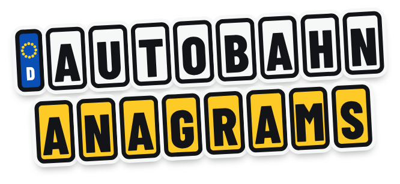
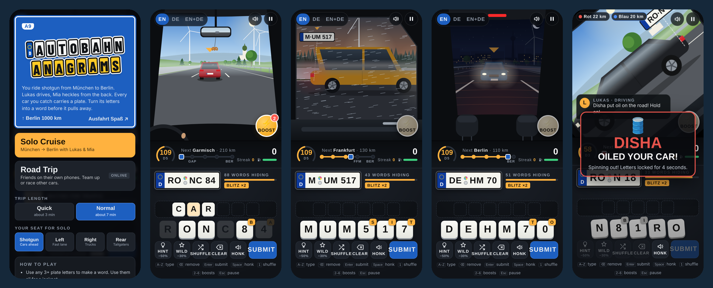

<p align="center">
  
</p>

<p align="center">
  <b>A road-trip word game. Spot German license plates, unscramble them, race your friends to Berlin.</b><br>
  Works in any browser, on phones and laptops. Install it like an app. No sign-up.
</p>

<p align="center">
  <a href="https://YOUR-LINK.vercel.app"><b>▶ Play now</b></a>
</p>

<p align="center">
  
</p>

---

## How to play

You're in a car driving from München to Berlin. Cars pull up next to you, and each one carries a German license plate like **`M·UM 517`**.

1. Make a word from the plate's letters (3 letters or more). Use every letter for a **jackpot**.
2. **Numbers are letters in disguise:** `0`=O, `1`=I, `3`=E, `4`=A, `5`=S, `7`=T, `8`=B
3. Answer in under 5 seconds for **double points**.
4. Every word fills up your tank. Every car that gets away drains it. Run dry and the trip is over.

Words count in **English, German, or both** (you pick).

## Game modes

| Mode | Players | How it works |
|---|---|---|
| **Solo Cruise** | 1 | Ride with Lukas (driving) and Mia (back seat). Beat your best score. |
| **Convoy** | 2 to 4 | Everyone in one car on their own phone. One shared tank and score. |
| **Rally** | 2 to 16 | Up to 4 team cars race to Berlin. First car there wins. 1v1, 2v2, 3v3, 4v4. |

Every trip is **Quick (about 3 min)** or **Normal (about 7 min)**.

### Pick your window seat
Each seat gives you a different view and different plates:

| Seat | What you see |
|---|---|
| **Shotgun** | Windshield. Cars in front of you. |
| **Left window** | The fast lane. Cars overtaking you. |
| **Right window** | Trucks and slow cars you pass. |
| **Rear window** | Tailgaters behind you. |

## Boosts and pranks ⚡

Spend your points with the round **Boost** button:

| Boost | Cost | Per trip | What it does |
|---|---|---|---|
| 🛢️ Oil slick | 800 | 3× | The leading rival spins out. Their letters lock for 4 seconds. *(Rally)* |
| 🌫️ Fog bomb | 600 | 3× | The leading rival's letters go blurry for 7 seconds. *(Rally)* |
| 🚀 Turbo | 700 | 2× | Your car goes 60% faster for 10 seconds. |
| ⛽ Refuel | 500 | 3× | +40 fuel. |
| 🛡️ Shield | 400 | 3× | Blocks the next prank aimed at you. *(Rally)* |

Limits are per car, shared by everyone in it. Each car waits 25 seconds between boosts, and a car that just got pranked is safe for 20 seconds.

Everyone sees a big banner saying who did what: **"DISHA OILED TEAM BLAU"**.

Watch out for **gold plates**. They're worth triple points.

## Controls

| Action | Phone | Keyboard |
|---|---|---|
| Add a letter | Tap a tile | Type the letter |
| Remove a letter | Tap it in your word | Backspace |
| Submit | Submit | Enter |
| Shuffle tiles | Shuffle | 1 |
| Boosts | ⚡ Boost | 2 to 6 |
| Honk | Honk | Space |
| Hint (−50% points) | Hint | |
| Borrow a letter (−30%) | Wild | |
| Pause | ⏸ | Esc |

## Install it like an app

- **iPhone (Safari):** Share → **Add to Home Screen**
- **Android (Chrome):** ⋮ menu → **Install app**

---

## Run your own copy

Everything here is free: GitHub, Vercel (hosting) and Supabase (the live connection between phones).

### 1. Supabase
1. Create a project at [supabase.com](https://supabase.com) (region Frankfurt is good for Europe).
2. Open **SQL Editor → New query**, paste the contents of [`supabase-setup.sql`](supabase-setup.sql) and click **Run**.
3. Under **Project Settings → API Keys**, copy the **Project URL** and the **publishable** key (the "anon" key also works).

### 2. Add the keys
Paste both into [`config.js`](config.js):

```js
window.AA_CONFIG = {
  supabaseUrl: "https://xxxx.supabase.co",
  supabaseAnonKey: "sb_publishable_xxxx"
};
```

> **Is this safe in a public repo?** Yes. The publishable key is made to be public. Every player's browser receives it anyway. Never put the **secret** or **service_role** key here.

### 3. Deploy on Vercel
1. Import this repo at [vercel.com](https://vercel.com) → **Add New → Project**.
2. Framework preset: **Other**. Leave everything else as it is. Click **Deploy**.

### 4. Check it
- `https://your-link.vercel.app/api/keepalive` shows `"ok":true`
- Vercel → **Settings → Cron Jobs** lists `/api/keepalive` (runs daily)
- Open the game on two devices → **Road Trip**: the lobby says **Online**

Without keys, Road Trip runs in **test mode**: only tabs in the same browser can join. Handy for trying it out.

### Try it on your computer
```bash
python3 -m http.server 8000
```
Then open http://localhost:8000 in two tabs.

---

## What's in the repo

```
index.html            The page
game.js               Game, 2D road renderer, multiplayer
words.js              English + German word lists (~50,000 words)
config.js             Supabase URL + publishable key
api/keepalive.js      Daily ping so the free Supabase project never pauses
vercel.json           Runs the keep-alive once a day
supabase-setup.sql    Creates the tiny keep-alive table
manifest.webmanifest  Makes it installable as an app
sw.js                 Minimal service worker (needed for install)
icons/                App icons, favicon, logo, link-preview image
docs/                 README screenshots
_head.html, build.py  Source of index.html (edit _head.html, then run python3 build.py)
```

## How it works

- **No framework, no build step.** Plain HTML, CSS and JavaScript. The road, cars, weather and window views are drawn live on a canvas.
- **Multiplayer** uses Supabase Realtime broadcast. There's no game database. The person who creates the trip runs the scoreboard, and if they drop out, the next player takes over.
- **Words** come from frequency lists, so plates use real, common words. Every plate is built so it has at least one good answer.

## Free tier limits

- **Supabase free:** about 200 people online at once and 2 million live messages a month. A 6-minute trip with 4 players uses roughly 3,000.
- **Vercel Hobby:** free for personal, non-commercial projects.
- Supabase pauses free projects after 7 days without use. The daily keep-alive stops that.

## Troubleshooting

| Problem | Fix |
|---|---|
| Lobby says **Test mode** | The keys in `config.js` are empty or didn't save. |
| Lobby says **Connection problem** | Supabase → **Realtime → Settings** → allow public channels. |
| `/api/keepalive` shows an error | The SQL step didn't run, or the key in `config.js` has a typo. |
| Old app icon on your phone | Delete the home-screen icon and add it again. |

## License

[MIT](LICENSE). Use it, change it, share it. Just keep the copyright line.
